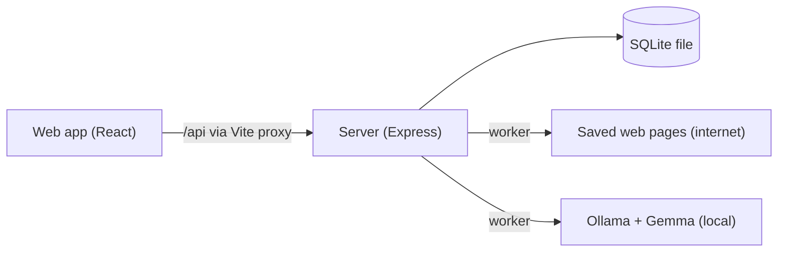

# Actwise Engineering Playbook

Status words used here: **tested** (automated test passes), **observed** (I saw it work once by hand), **planned** (not built).

## A. Problem and goals

- Problem: saved bookmarks never get revisited because going back costs mental and typing effort. Saving only delays the guilt.
- Hypothesis (untested): a short, tap-only Today list, each item with a reason and one small next step, is easier to act on than a saved link.
- MVP: import a Chrome bookmarks file, read the pages slowly in the background, analyse them with a local open model, score them with plain code, show at most three on Today.
- Non-goals: browser extension, LinkedIn scraping, automatic applications, accounts, cloud hosting.
- Success I actually checked: the loop works end to end, no urgency is invented, failures are shown honestly.
- Success I did not check: whether it makes me act more. No measured time saving.

## B. Architecture

- Web: import screen, Today cards, tap buttons. Server: routes, import, worker, scoring. SQLite: one table.
- Trust boundaries: the Chrome file is user-provided; saved web pages are untrusted; the model's answer is an untrusted guess; Ollama runs locally.
- Only `fetching/safeFetch.ts` talks to the web. Scoring is pure code with no database or network.
- One worker does one job at a time: page reads first (cheap), then the model (slow). This also protects an 8 GB machine.

## C. Data model and API

One table `items`. Who owns each field:
- From the Chrome export: url, title, folder path, saved date.
- From the web: page text (first 4000 characters), untrusted.
- From the model: type, summary, why it may matter, requirements, topics, deadline quote and date, next step, unknowns. Stored only after the strict form check.
- From plain code: deadline state (verified, mentioned, unknown). Scores are not stored; they are computed on read because urgency depends on today's date.
- From the user: status (new, doing, done, later, dropped) and snooze time.

Endpoints: `GET /api/health`, `POST /api/import` (raw HTML text, 10 MB limit), `GET /api/items` (first 100), `PATCH /api/items/:id` (action: do, done, later, drop), `GET /api/status`, `GET /api/today`.
Errors always look like `{ "error": { "code": "...", "message": "..." } }` (EMPTY_BODY, NO_BOOKMARKS_FOUND, TOO_LARGE, BAD_ID, BAD_ACTION, BAD_JSON, NOT_FOUND, INTERNAL).
Duplicates: links are cleaned (no tracking parameters, fragment or trailing slash); the first copy wins; a UNIQUE rule in the database is the backstop. The database also rejects invalid status words.
Known gap: any action can be applied from any status; there are no transition rules.

## D. AI pipeline

- The model reads language: it fills a strict form. It does not decide priority, urgency, or what happens next.
- Ollama `/api/chat` with the form sent as a JSON schema, temperature 0, 4096 context, 240 second timeout. Default model `gemma3:4b`.
- The answer is checked with zod. If it is not valid JSON or does not fit, it gets one retry with feedback, then the item is marked failed with a reason.
- Model problem versus page problem: if Ollama is off or the model is missing, the item stays pending, a banner explains, and the worker retries every 30 seconds. If the model answered but the answer was unusable, only that item fails.
- Deadlines: the model must quote the sentence. The deadline is verified only if the quote appears in the page text and our own date reader finds exactly one clear date in it that matches the model's date. Otherwise it is "mentioned" (shown with a warning, no urgency) or "unknown". Ambiguous dates like 03/04/2026 are refused.
- Prompt injection: page text is passed as data between markers, marker text inside a page is neutralised, and the prompt calls the page untrusted. A prompt cannot force behaviour, so the real protection is the strict form, deadline verification, and the fact that nothing the model writes triggers an action.
- The original bookmark survives any failure: title, link, folder and date are saved before any page is read.
- Model license: Gemma 3 is open-weight under Google's own terms, not an OSI open-source license. I did not review the full text; check the current terms before redistributing.

## E. Priority and the Why Engine (HYPOTHESIS, not evaluated)

score = 100 x (0.45 relevance + 0.35 urgency + 0.10 small effort + 0.10 time since saved)
- relevance: goal words found in summary, topics and requirements; two or more matches counts as 1. The model's own "why it may matter" text is ignored.
- urgency: verified deadlines only: 3 days or less 1, 7 days 0.8, 14 days 0.5, 30 days 0.25, later 0.1, none 0. Passed deadlines are hidden.
- small effort: repo 1, learning 0.8, other 0.6, hackathon 0.5, job 0.4. These are guesses.
- time since saved: days saved divided by 180, capped at 1.
- Items with no goal match and no verified deadline stay off Today. Items in progress stay on top. Today shows at most 3.
- Why plain code: the model guesses; scoring must be explainable and testable.

Worked example (by hand from the formula; the UI does not show scores): the Frontend Intern demo page had four matched goals (relevance 1), a verified deadline 14 days away (urgency 0.5), type job (effort 0.4) and was saved 589 days ago (age 1). Score = 100 x (0.45 + 0.175 + 0.04 + 0.10) = about 77. I did not write worked examples for the other types.

## F. Decisions

1. Chrome export file, not Chrome's internal bookmarks file: the internal file depends on install paths and file locks. Revisit if exporting annoys users.
2. Node's built-in `node:sqlite`, not better-sqlite3: better-sqlite3 crashed on load on my Windows laptop (Node 22.13.0, exit code -1073741819, reproduced outside the test runner). Trade-offs: an experimental warning, Node 22.13 or newer, transactions written by hand.
3. Raw-text upload, not multipart: a bookmarks file is just text.
4. Duplicates by cleaned URL, first copy wins.
5. Scoring by plain code, not by the model.
6. Scores computed on read, not stored, because urgency changes daily.
7. No "running" state in the database: a crash leaves the item pending and it is simply retried; failures always leave the queue so nothing can loop forever.
8. Demo pages are fictional and hosted on GitHub Pages because the fetcher correctly refuses localhost.
9. Failed items are not retried automatically; `scripts/retryFailed.ts` does it by hand.

## G. Testing

Automated with Vitest and Supertest, in-memory database, fake network and fake model. Last observed run: 16 files, 105 tests passing, typecheck clean, web build succeeded. See `docs/TEST_PLAN.md`. Not automated: the fetch timeout, the real model, the web screens.

## H. Security, privacy, reliability

| Safeguard | Status |
|---|---|
| Only http/https links | tested |
| Private/local addresses blocked, re-checked on every redirect, max 3 redirects | tested (fake network) |
| 1 MB page limit, HTML only | tested |
| 10 second fetch timeout | built, not tested |
| Strict model output form, deadline verification | tested |
| SQL values bound as parameters; database rejects invalid status | tested |
| Logs contain ids and timings, not links or page text | built, not audited |
| Bind server to 127.0.0.1 | **planned** (today it listens on all interfaces, no login) |
| DNS rebinding protection | **planned** |
| Automatic retry of temporary failures | **planned** |

Privacy: the model runs locally, but the worker contacts every saved link, so those sites see requests from this laptop. The worker can be turned off with `ACTWISE_WORKER=off`.

## I. Observability and measurements

Available: one log line per analysis (id, seconds, attempts), `GET /api/status` with counts and failure reasons, `scripts/stats.ts`.

Measured on 25 October 2026, gemma3:4b via Ollama, Windows laptop with 8 GB RAM. The database also held 9 older test items (7 fake sample links that returned 404, plus React and npm Docs), so these are for the 8 real pages:
- Read: 7. Unreadable: 1 (Learn SQL demo, `no_readable_text`, cause not investigated).
- Analysed: 6. Timed out: 1 (Campus Build Sprint demo, 240 second limit).
- Second attempts needed: 0 of 6.
- Seconds per analysis: about 48 to 96, average 68.5.
- Deadline states: 2 verified, 1 mentioned, 3 unknown.
- Types: job 2, repo 2, hackathon 1, other 1.
- Not measured: user acceptance, completion of next steps, time saved.

## J. Setup and limitations

See README for setup and settings. Main limitations: slow small model, 4000-character page window, UTC day boundaries, substring goal matching, non-UTF-8 pages may look garbled, single user on one machine.

## K. Implementation log

- Slice 1: skeleton and health check (observed).
- Slice 2: URL cleaner, bookmark parser, SQLite import, import and list endpoints (tested). Bug: better-sqlite3 crashed the test worker on Windows; fix: node:sqlite.
- Slice 3: import screen (observed: success message, duplicates, bad file, server-off message).
- Slice 4: safe fetching, text extraction, background worker, status endpoint (tested; observed on real sites). The fake sample links returned 404 as expected.
- Slice 5: strict form, deadline checker, prompt, Ollama client, analysis with one retry, model-versus-page failure handling (tested; observed with the real model).
- Slice 6 and 7: scoring, Today list, tap actions, Today screen (tested server side; screen observed once).
- Real run: 6 of 8 pages analysed; one timeout; one unreadable page. Model weaknesses: invented a benefit ("full-time role"), one oversized next step.
- Mistake: I did not clear the database before the run, so the first statistics mixed in older test items. The tables above separate them.