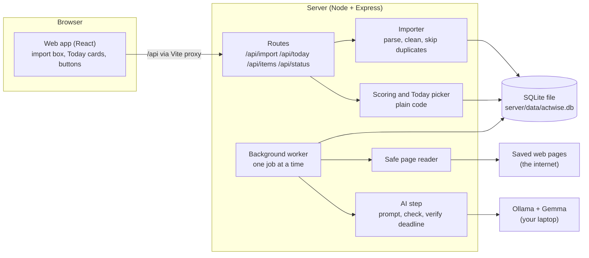
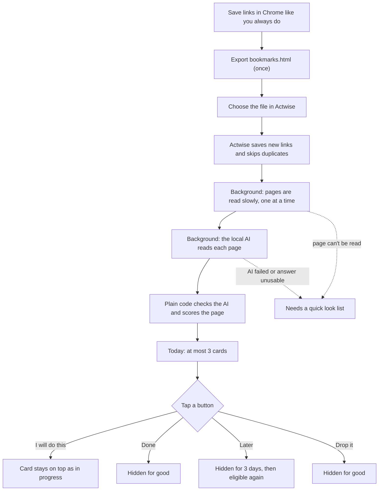
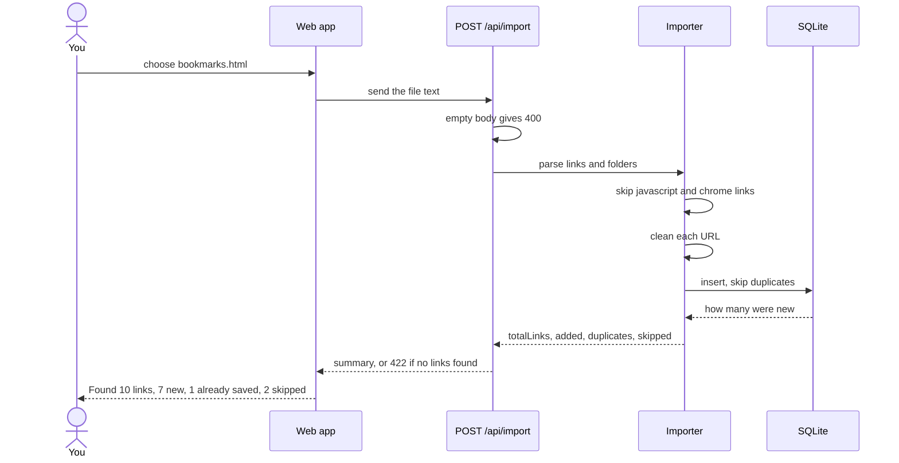
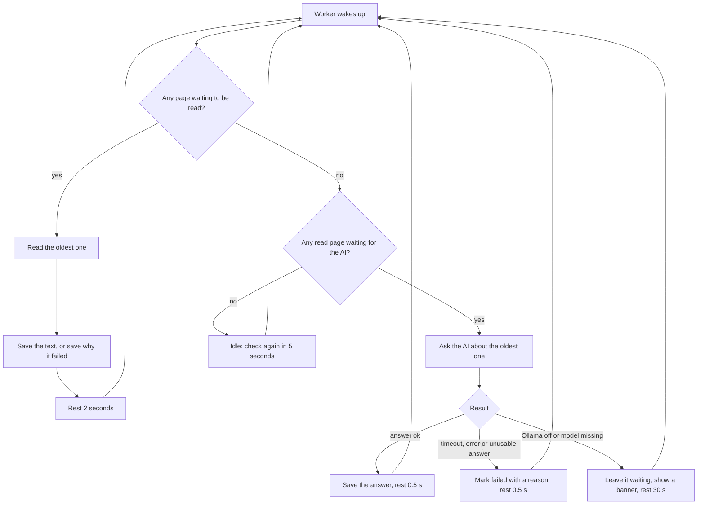
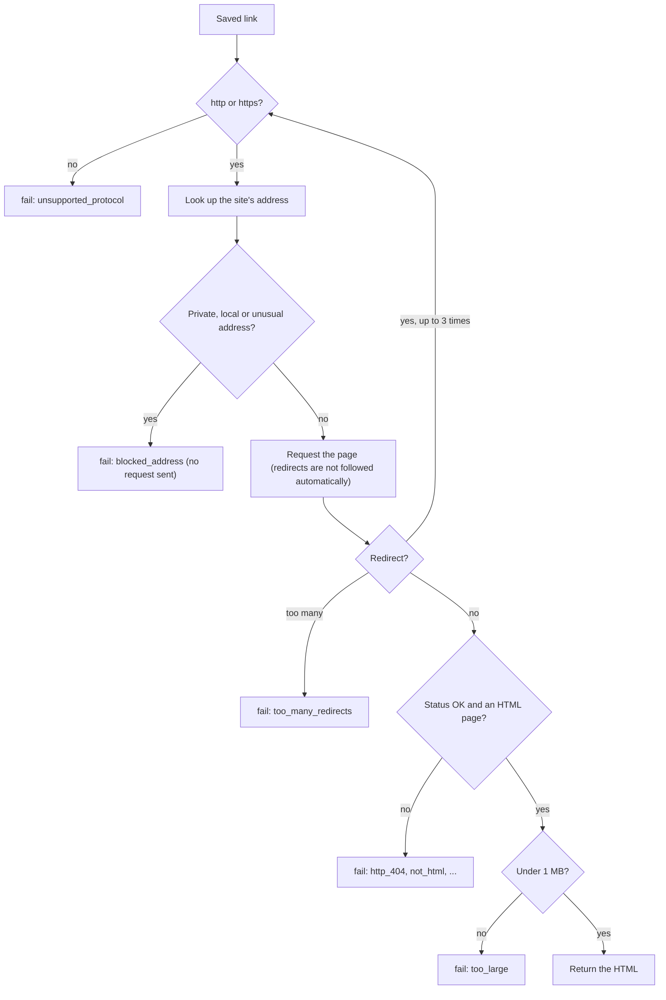
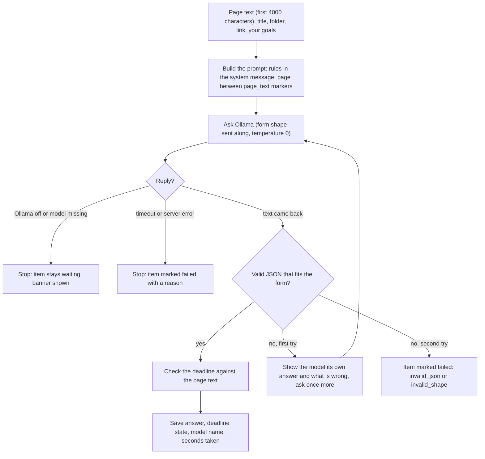
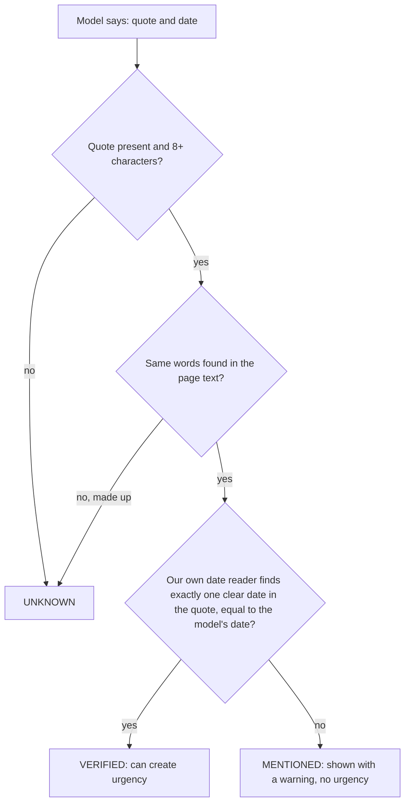
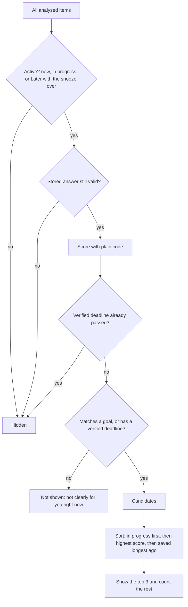
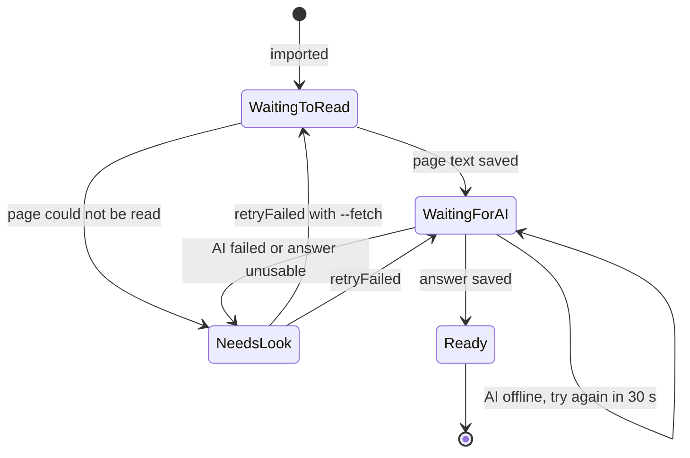

# ActWise

Know what matters. Act on it.

ActWise is my entry for the Hacktoberfest Open-Source AI Challenge, Week 3 (Slow and Steady).

It reads your Chrome bookmarks, uses a small open-weight model running on your own laptop to understand each saved page, and shows at most three things worth acting on. The rest of the pile stays out of the way.

Status: built in one day. It ran end to end once on the author's laptop. It has not been used by anyone else and has not been evaluated with real users.

## The problem

Saving a link feels productive. Going back to it takes effort, so the saved pile only grows and the guilt grows with it. Actwise tries to remove that effort: import once, let it work through the pile slowly in the background, then only tap buttons.

## How it works

1. Export your bookmarks from Chrome (Bookmark manager, three dots, Export bookmarks) and import the file.
2. A slow background worker visits each link, one every couple of seconds, and extracts the readable text.
3. A local model (through Ollama) fills in a strict form: type, summary, why it may matter, requirements, deadline quote, next step, unknowns.
4. Plain code checks the model. The answer must fit the form. A deadline only counts as verified if the quoted sentence really appears on the page and the date in it matches.
5. Plain code scores each item from your goals, verified deadlines, effort and age. The model never decides priority.
6. The Today screen shows the top three with buttons: I will do this, Later (hides 3 days), Drop it. Pages that could not be read are listed under "Needs a quick look".

## How it works in depth

### Who does what

| Job | Done by |
|---|---|
| Understanding language: what a page is, a summary, why it may matter, a next step | The local model (Gemma through Ollama) |
| Everything else: reading the file, cleaning links, saving, fetching pages safely, checking the model's answer, verifying deadlines, scoring, hiding and showing, the buttons | Plain code |

The model is treated like a smart but sloppy intern: it fills in a form, and the code checks the form against the real page. Nothing the model writes can trigger an action or change the score by itself.

### 1. The big picture



The only code allowed to touch the internet is the safe page reader. The only thing that talks to the model is the AI step. The scoring code never touches the database or the network, which makes it easy to test.

### 2. Your workflow



You never type anything after the import. While pages are still waiting, the web page checks for news every 5 seconds, so cards appear on their own.

### 3. What happens when you import



The importer turns messy links into one standard form so the same page saved twice is caught:

| Rule | Example |
|---|---|
| Only `http` and `https` links are kept | `javascript:` and `chrome://` are skipped |
| Site name lowercased, `#fragment` removed | `EXAMPLE.com/a/#apply` becomes `example.com/a` |
| Tracking parameters removed (`utm_*`, `fbclid`, `gclid`, `mc_cid`, `mc_eid`, `igshid`) | `?utm_source=x` disappears |
| Other parameters kept and sorted | `?b=2&a=1` becomes `?a=1&b=2` |
| Trailing slash removed | `/jobs/` becomes `/jobs` |

The first copy wins. The database also has a UNIQUE rule on the cleaned link as a backstop. Folder names are saved as paths like `Bookmarks bar > inter > job`, and Chrome's saved date is kept when present.

### 4. The slow background worker



Design choices:
- **One job at a time**, pages before AI, to be gentle on websites and on an 8 GB laptop.
- **No "in progress" state in the database.** If the app crashes mid-job, the item is still waiting and is simply retried. Nothing gets stuck.
- **Failures always leave the queue**, so one bad link can't make the worker loop forever.
- **Model problem versus page problem:** if the model is unavailable, the item is not blamed. If the page can't be read, only that page is marked.
- Pages with fewer than 40 readable characters are marked `no_readable_text` (login walls, empty pages, pages that need JavaScript) instead of being sent to the model.
- Timings and limits live in `server/src/config.ts`.

### 5. The safe page reader

The server visits links by itself, and a bookmark file is data from outside. A malicious link could point at your own laptop or home network, so the reader acts like a careful courier:



Redirects are followed by hand so every new stop gets the same address check, otherwise a safe-looking site could redirect to a forbidden one. It never throws: it returns either the page or a short reason code, so the worker can record it and move on. Limits: 10 second timeout, 1 MB page size, no cookies sent.

Known gaps: the address is checked and then fetched separately, so DNS rebinding is not fully closed, and the 10 second timeout has no automated test.

Readable text is then extracted: scripts, styles and tags removed, the page's own description placed first, cut to the first 4000 characters.

### 6. The AI step



The form the model must fill in: `type` (job, hackathon, repo, learning, other), `summary`, `why_it_may_matter`, `requirements`, `topics`, `deadline_quote`, `deadline_date`, `next_step`, `unknowns`. The form is sent to Ollama so the output is shaped while it is written, and then checked again by the code. Extra fields the model adds are dropped.

**Prompt injection:** page text is passed as data between markers, any marker text inside a page is neutralised, and the prompt tells the model the page is untrusted and to list missing facts under `unknowns` instead of guessing. A prompt cannot force behaviour, so the real protections are the strict form, the deadline check below, and the fact that nothing the model writes triggers an action.

**Observed limits of a 4B model:** it once invented a benefit ("potentially leading to a full-time role") and wrote a next step far bigger than 10 minutes. The card labels that text as an AI guess and the scoring ignores it.

### 7. How a deadline becomes "verified"

Think of a customs officer: the model says "this page has a deadline", and the code doesn't believe it until it opens the bag and finds the sentence.



| Page says | Result |
|---|---|
| "Applications close on 30 Nov 2026" and the model gives 2026-11-30 | Verified |
| "Deadline tomorrow" or "Apply TODAY" (no real date) | Mentioned |
| "Opens 1 Oct 2026 and closes 30 Nov 2026" (two dates) | Mentioned |
| A quote that is not on the page | Unknown |
| "03/04/2026" (could be March 4 or April 3) | Not understood, so never verified |

Understood date styles: `2026-11-30`, `30 Nov 2026`, `30th November, 2026`, `Nov 30, 2026`. Impossible dates like 31 Feb 2026 are rejected. Days are counted in UTC, so near midnight the count can be off by one. Only the first 4000 characters of a page are read, so a deadline further down shows as unknown.

### 8. Scoring and the Today list (a hypothesis, not evaluated)

score = 100 x (0.45 relevance + 0.35 urgency + 0.10 small effort + 0.10 time since saved)

| Part | How it is computed |
|---|---|
| Relevance | Your goal words found in the summary, topics and requirements. Two or more matches = 1. The model's own "why it may matter" text is ignored, so it can't flatter itself. |
| Urgency | Verified deadlines only: 3 days or less = 1, 7 days = 0.8, 14 days = 0.5, 30 days = 0.25, later = 0.1, no verified deadline = 0 (never a penalty). |
| Small effort | A guess by type: repo 1, learning 0.8, other 0.6, hackathon 0.5, job 0.4. |
| Time since saved | Days saved divided by 180, capped at 1. |



Scores are computed whenever Today is requested, not stored, because urgency changes every day. Your goals come from `ACTWISE_GOALS`. The weights and tables are guesses I have not tested with real users.

### 9. What happens to one saved link



Your own status is separate: `new`, `doing`, `done`, `later` (hidden for 3 days), `dropped`. Any button can be pressed from any status; there are no transition rules.

### 10. API

| Endpoint | What it does |
|---|---|
| `GET /api/health` | `{ "status": "ok" }` |
| `POST /api/import` | Body is the raw bookmarks file text (10 MB limit). Returns `totalLinks, added, duplicates, skipped`. |
| `GET /api/items` | Total and the first 100 saved items |
| `PATCH /api/items/:id` | Body `{ "action": "do" \| "done" \| "later" \| "drop" }` |
| `GET /api/status` | Counts of pages and analyses, failure reasons, and whether the model has a problem |
| `GET /api/today` | Up to 3 cards, counts, the "needs a quick look" list, your goals, model problem |

Every error has the same shape: `{ "error": { "code": "...", "message": "..." } }`, with codes such as `EMPTY_BODY`, `NO_BOOKMARKS_FOUND`, `TOO_LARGE`, `BAD_ID`, `BAD_ACTION`, `BAD_JSON`, `NOT_FOUND` and `INTERNAL`.

### 11. What each field is and how far to trust it

| Data | Comes from | Trust |
|---|---|---|
| Link, title, folder, saved date | Your Chrome export | As given |
| Page text | The web | Untrusted |
| Type, summary, why it may matter, requirements, topics, next step, unknowns | The model | An unchecked guess, shown with a label |
| Deadline state (verified, mentioned, unknown) | Plain code, from the model's quote and the page text | Derived and checked |
| Score and reasons | Plain code | Derived, reproducible |
| Status and snooze time | You | As given |

### 12. What goes wrong and what happens

| Situation | What Actwise does |
|---|---|
| Same link saved twice | Second copy skipped, counted as a duplicate |
| Not a bookmarks file | Red message, nothing saved |
| Page gone, blocked, too big or not HTML | Marked failed with a reason, shown under "Needs a quick look" |
| Page has almost no readable text | Marked `no_readable_text`, shown under "Needs a quick look" |
| Ollama not running or model not pulled | Items stay waiting, banner shown, retried every 30 seconds |
| Model takes longer than 4 minutes | That item marked failed (`model_timeout`) |
| Model returns broken JSON or the wrong shape | One retry with feedback, then marked failed |
| Model invents a deadline | Not on the page, so it shows as unknown |
| Page tries to give the AI orders | Treated as page text; cannot change a score |
| App crashes mid-run | Unfinished items are still waiting and continue on restart |
| Server not running | The web page says it cannot reach the server |

### 13. Where the code lives

| Folder | Files |
|---|---|
| `server/src/import` | `parseBookmarks.ts`, `normalizeUrl.ts`, `importBookmarks.ts` |
| `server/src/db` | `database.ts` (table and rules), `itemsRepo.ts` (all SQL) |
| `server/src/fetching` | `safeFetch.ts`, `extractText.ts` |
| `server/src/ai` | `analysisSchema.ts`, `prompt.ts`, `ollamaClient.ts`, `analyze.ts`, `verifyDeadline.ts` |
| `server/src/worker` | `worker.ts`, `workerState.ts` |
| `server/src/scoring`, `server/src/today` | `priority.ts`, `buildToday.ts` |
| `server/src/routes` | `importRoute.ts`, `itemsRoute.ts`, `statusRoute.ts`, `todayRoute.ts` |
| `server/src` | `index.ts` (starts everything), `app.ts` (builds the app), `config.ts` (settings) |
| `web/src` | `api.ts`, `App.tsx`, `components/ImportBox.tsx`, `ItemCard.tsx`, `NeedsLook.tsx` |


## What I observed in the first real run

Run on 25 October 2026 on a Windows laptop with 8 GB RAM, using `gemma3:4b` through Ollama. The database held older test items too, so the numbers below are only for the 8 real pages (my 6 fictional demo pages plus the public React and npm Docs sites).

| Page | Result |
|---|---|
| Frontend Intern (demo) | Analysed as a job. Deadline verified (8 Nov 2026). Shown on Today with "14 day(s) left". |
| tiny-ui-kit (demo) | Analysed as a code project, no deadline. Shown on Today. |
| AI Growth Intern "LAST CHANCE" (demo) | Analysed as a job. Deadline state "mentioned", not verified, so it adds no urgency. I did not record whether it appeared in the top three. |
| Summer Code Jam (demo, already closed) | Analysed. Deadline verified, in the past. By design it is hidden from Today (covered by an automated test; I did not check it on screen). |
| Campus Build Sprint (demo) | Analysis timed out at the 4 minute limit. Not analysed. |
| Learn SQL (demo) | Page read failed with `no_readable_text`. Cause not investigated. |
| React, npm Docs (public sites) | Analysed, no deadline. |

Totals for those 8 pages: 7 read, 1 unreadable; 6 analysed, 1 timed out. None of the 6 analyses needed a second attempt. Analysis took between roughly 48 and 96 seconds per page, 68.5 seconds on average (the first one includes loading the model).

Problems I saw in the model's text:
- It wrote that an internship was "potentially leading to a full-time role". The page never says that. The card labels this text as an AI guess, but it is still invented. The scoring code ignores that text.
- Its "next 10 minutes" step for one card was far bigger than 10 minutes.

## Open AI and privacy: what is true

- The model runs locally through Ollama. Page text goes to the model on your machine as long as `OLLAMA_URL` points to your own computer (the default). I did not test the app with the network switched off.
- The background worker visits the links you saved, so those websites can see requests from your laptop.
- Bookmarks and results are stored in a local SQLite file (`server/data/actwise.db`), which Git ignores.
- Actwise's own code sends no analytics. I did not audit Ollama, Node or the npm packages.
- Model weights are not in this repository. Gemma 3 is open-weight under Google's own terms of use, which are not an OSI-approved open-source license. Read the current terms on the model page before redistributing anything.
- Implemented and covered by automated tests (with fake network and fake model): only http/https links, private and local addresses blocked (also after redirects), size limit 1 MB, HTML only, strict output form, deadline verification.

## Known limits

- The server listens on all network interfaces and has no login. On a shared network, another device could reach its API. Planned fix: bind to 127.0.0.1.
- DNS rebinding is not fully closed (the address is checked, then fetched separately).
- The 10 second fetch timeout has no automated test.
- Failed pages are not retried automatically (`scripts/retryFailed.ts` does it by hand).
- A 4B model on 8 GB RAM is slow, timed out once, and sometimes invents or oversizes text.
- Only the first 4000 characters of a page are sent to the model, so a deadline further down looks unknown.
- Goal matching is a plain substring check ("react" also matches "reactive").
- The web screens have no automated tests. The GitHub Actions workflow is included but I have not yet seen it run.
- Scoring weights are a hypothesis. No user study. No measured time saving.
- Only Chrome's HTML export is supported.

## Requirements

- Node 22.13 or newer (uses the built-in `node:sqlite`, which prints an experimental warning)
- Ollama with a model pulled, for example `ollama pull gemma3:4b`
- 8 GB RAM is tight for a 4B model: close other apps while it runs

## Run it

```bash
# terminal 1
cd server
npm install
npm run dev

# terminal 2
cd web
npm install
npm run dev
```

Open http://localhost:5173 and import a bookmarks file.

To try the fictional demo, import `samples/demo-bookmarks.html`. The demo pages live in `docs/demo` and are served by GitHub Pages, because Actwise correctly refuses to read anything on localhost. If you fork this repo, enable Pages for the `/docs` folder and change the base address inside `samples/demo-bookmarks.html`. The save dates in that file are made up.

## Settings (environment variables)

| Name | Default | Meaning |
|---|---|---|
| ACTWISE_MODEL | gemma3:4b | Ollama model to use |
| ACTWISE_GOALS | internship,frontend,react,typescript,hackathon,open source | Words your goals are matched against |
| ACTWISE_WORKER | on | Set to `off` to stop the background reader |
| OLLAMA_URL | http://127.0.0.1:11434 | Where Ollama runs |
| ACTWISE_DB_PATH | server/data/actwise.db | Database file |

Windows cmd example: `set ACTWISE_MODEL=gemma4:e2b&& npm run dev` (I only ran `gemma3:4b`).

## Tests

```bash
cd server
npm test
npm run typecheck
```

On my machine the last run showed 16 test files and 105 tests passing, typecheck clean, and the web build succeeding. Tests use fake models and fake pages, so they need no internet and no Ollama. See `docs/TEST_PLAN.md`.

## Scripts

- `npx tsx scripts/stats.ts` prints counts and the average analysis time (no links or page text)
- `npx tsx scripts/retryFailed.ts [--fetch]` puts failed items back in the queue
- `npx tsx scripts/tryFetch.ts <url>` shows what the safe reader sees on one page

## More

- `ENGINEERING_PLAYBOOK.md`: design, decisions and what is verified
- `docs/TEST_PLAN.md`: automated coverage and the manual check

## License

MIT for the code (see LICENSE). Model licenses are separate.

## Commits after the deadline
None so far. I will list any here.